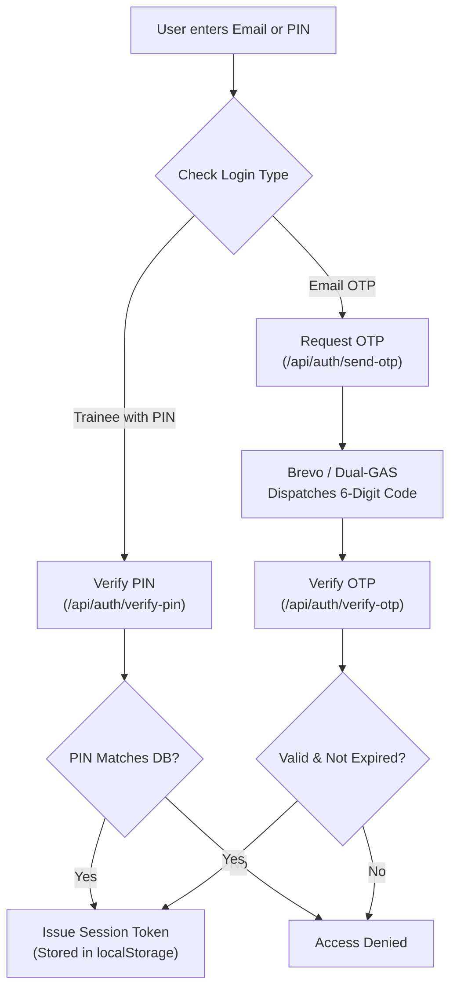

# Security, Authentication & Roles

This document covers authentication flows, session handling, Role-Based Access Control (RBAC), and security hardening in PD Hub.

---

## 1. Authentication Mechanisms

---

## 2. 4-Digit PIN Security
- **Target Audience:** EIU students, faculty, and recurring corporate trainees.
- **Leading Zero Text Integrity:**
  - Standard integer parsing truncates `0123` to `123`.
  - The database adapter and frontend treat PINs strictly as `VARCHAR` / `TEXT` and enforce `String(pin).padStart(4, '0')` during comparison to guarantee leading zeros are never lost.
- **PIN Change & Management:**
  - Trainees and Admins can update their 4-digit PIN in their respective Profile panels (`POST /api/trainee/pin/set` and `POST /api/admin/pin/set`).
  - Dual PIN confirmation (`confirmNewPin`) prevents accidental lockouts.

---

## 3. Real OTP Email Delivery & Hardening
- **Multi-Provider Fallback:** Dispatched primarily via Brevo REST API v3, with automatic rotation through Dual Google Apps Script (`GAS1` / `GAS2`) relays.
- **Concurrent Active OTP Sessions:**
  - `temp_otp` supports concurrent active codes for the same user across multiple browser tabs and devices, preventing race condition invalidations when users open verification on mobile and desktop simultaneously.
- **Case-Insensitive & Whitespace Trimming:**
  - Email lookups strictly apply `normalizeEmail()` (lowercased and stripped of whitespace), eliminating mobile autocorrect login failures.
- **Frontend Protection:**
  - Resend buttons are throttled by a 60-second countdown timer.
  - Verification inputs are locked to numeric input mode (`inputmode="numeric"`, `maxlength="6"`).

---

## 4. Role-Based Access Control (RBAC)

User permissions are evaluated against the `pdc_user_roles` master table:

| Role | Permitted Portals & Endpoints | Permissions |
|---|---|---|
| `admin` | `/admin/index.html`, `/report.html`, All APIs | Full operational control, role assignment, status checks, pending org approvals, logs inspection. |
| `report_viewer` | `/report.html`, `GET /api/report/*`, `POST /api/report/log-email-view` | Read-only analytics; redirected away from `/admin/index.html` if attempted. |
| *(Trainee)* | `/trainee/index.html`, `/api/trainee/*` | Scoped to own profile, registrations, and active courses. |
| *(Client)* | `/client/index.html`, `/api/client/*` | Scoped to inquiries matching corporate email. |

### Emergency Recovery Access (`DEBUG_TOKEN`)
In the event that email providers or OAuth tokens are temporarily disrupted, an emergency `DEBUG_TOKEN` can be supplied directly in the Admin login shell.
- **Security:** Concealed behind `?debug=1` parameter; never stored in client storage; audit-logged on every diagnostic invocation.

---

## 5. Data Privacy & Operational Audit Trail

### Feedback Trainee Email Concealment
In `/report.html`, trainee emails attached to survey quote responses are masked by default to protect respondent privacy.
- **Audit Requirement:** Whenever an administrator or report viewer reveals emails (via the UI switch, generating an A4 print document, or exporting CSV), an audit event is dispatched to `POST /api/report/log-email-view`.
- **Logged Event:** `report_feedback_email_viewed` is written to `pdc_app_logs` with scope `admin`, recording the viewer email, section ID, mapping ID, and action (`show`, `print`, or `csv_export`).
